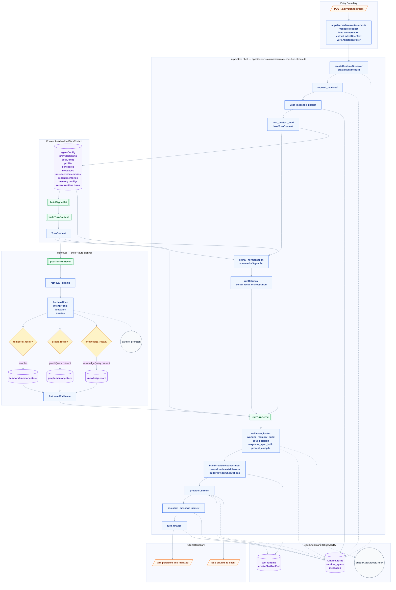
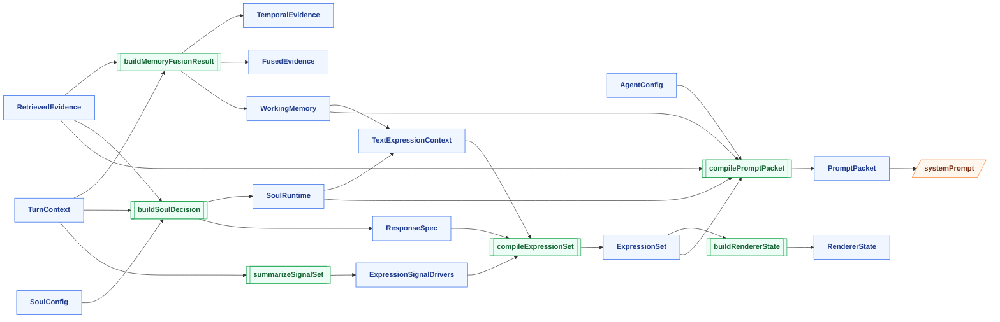

# Chat Turn Runtime Pipeline — Canonical Runtime Diagram

> 配套文档：
>
> - [ARCHITECTURE.md](../../../ARCHITECTURE.md)
> - [runtime-kernel-implementation-plan.md](../../runtime-kernel-implementation-plan.md)
> - [soul-runtime-observability.md](../soul-runtime-observability.md)

---

## 图例 Legend

|  形状   | 含义                                            | 用法                                         |
| :-----: | ----------------------------------------------- | -------------------------------------------- |
| `[/ /]` | 外部输入 / 输出边界                             | `POST /chat/stream`、`SSE chunks`            |
|  `[ ]`  | Runtime shell stage / runtime span              | `request_received`、`prompt_compile`         |
| `[[ ]]` | 纯函数 / pure composition                       | `planTurnRetrieval`、`runTurnKernel`         |
|  `{ }`  | 分支 / gate / final status split                | `pre-recall?`、`provider outcome?`           |
| `[( )]` | Store / DB / Provider / Tool / side effect edge | `messages`、`temporal store`、`chat adapter` |
| `(( ))` | side-channel / background task / timeout signal | `queueAutoDigestCheck`、`idle timeout`       |

说明：

- 这份图以当前代码为准，而不是只按架构草案抽象命名
- `apps/server/src/runtime/create-chat-turn-stream.ts` 是当前 canonical orchestration shell
- `packages/core/src/runtime/*` 是纯 runtime kernel；store recall、provider stream、tool execution、persistence 仍留在 server shell

---

## Chart 1: End-to-End Canonical Turn Flow



---

## Chart 2: `runTurnKernel` Expansion

这张图把 `packages/core/src/runtime/run-turn-kernel.ts` 展开，强调当前 runtime kernel 里哪些步骤已经是纯函数组合。



---

## Chart 3: Provider Stream, Tool Hooks, and Finalization

这张图展开 `provider_stream` 之后的生命周期，因为这一段是当前 turn shell 里最厚的一层。

```mermaid
flowchart TB
    classDef ext fill:#fff7ed,stroke:#f97316,color:#7c2d12,font-weight:bold
    classDef stage fill:#eff6ff,stroke:#2563eb,color:#1e3a8a,font-weight:bold
    classDef gate fill:#fef3c7,stroke:#d97706,color:#92400e,font-weight:bold
    classDef store fill:#f5f3ff,stroke:#7c3aed,color:#5b21b6,font-weight:bold
    classDef event fill:#f8fafc,stroke:#64748b,color:#334155,font-weight:bold

    PREP[provider request input<br/>chat options<br/>runtime middleware]:::stage
    CHAT[(chat adapter and provider stream)]:::store
    ONSTART[onStart<br/>open provider_stream span]:::stage
    CHUNK{chunk type?}:::gate
    TEXT[append assistantText<br/>recordProviderTextContribution]:::stage
    TOOLS[onBeforeToolCall<br/>onAfterToolCall<br/>onToolPhaseComplete]:::stage
    TOOLSPAN[tool_call span open or close]:::stage
    FINISH[onFinish or onAbort or onError<br/>classifyProviderStreamOutcome]:::stage
    RESOLVE[resolveTurnFromProviderOutcome]:::stage
    STATUS{provider turn status?}:::gate
    HASMSG{assistantText.trim() present?}:::gate
    AP[assistant_message_persist]:::stage
    SKIP[skip assistant_message_persist]:::stage
    FINAL[turn_finalize]:::stage
    TIMEOUT((idle timeout or abort signal)):::event
    SSE[/yield SSE chunks/]:::ext
    STORE[(runtime_spans<br/>runtime_turns<br/>messages)]:::store

    PREP --> CHAT --> ONSTART --> CHUNK
    CHUNK -->|TEXT_MESSAGE_CONTENT| TEXT --> SSE --> CHUNK
    CHUNK -->|tool activity| TOOLS --> TOOLSPAN --> CHUNK
    CHUNK -->|stream completed| FINISH --> RESOLVE --> STATUS

    TIMEOUT -.-> STATUS
    STATUS -->|aborted| FINAL
    STATUS -->|failed| FINAL
    STATUS -->|completed| HASMSG
    HASMSG -->|yes| AP --> FINAL
    HASMSG -->|no| SKIP --> FINAL

    ONSTART -.-> STORE
    TOOLSPAN -.-> STORE
    FINISH -.-> STORE
    AP --> STORE
    SKIP -.-> STORE
    FINAL --> STORE
```

---

## Code Anchors

- Canonical route entry: `apps/server/src/routes/chat.ts`
- Canonical turn shell: `apps/server/src/runtime/create-chat-turn-stream.ts`
- Context loading: `apps/server/src/runtime/load-turn-context.ts`
- Retrieval orchestration: `apps/server/src/runtime/run-retrieval.ts`
- Runtime observer and span persistence: `apps/server/src/runtime/runtime-observer.ts`
- Pure retrieval planning: `packages/core/src/runtime/plan-turn-retrieval.ts`
- Pure runtime kernel: `packages/core/src/runtime/run-turn-kernel.ts`
- Turn contracts and stage enum: `packages/contracts/src/runtime/turn.ts`, `packages/contracts/src/runtime/turn-context.ts`

## Notes

- 当前代码真实发出的主 span 顺序是：`request_received` -> `user_message_persist` -> `turn_context_load` -> `signal_normalization` -> `retrieval_signals` -> `retrieval_plan` -> `temporal_recall?` -> `graph_recall?` -> `knowledge_recall?` -> `evidence_fusion` -> `working_memory_build` -> `soul_decision` -> `response_spec_build` -> `prompt_compile` -> `provider_stream` -> `tool_call*` -> `assistant_message_persist?` -> `turn_finalize`
- `temporal_recall`、`graph_recall`、`knowledge_recall` 现在按统一 `RetrievalPlan` 独立启动，逻辑上是并行 prefetch，不再通过执行顺序暗示数据依赖
- `runtimeStageSchema` 已切到新 retrieval stage 命名；`soul_runtime` 和 `prompt_build` 仍是尚未在 canonical path 发出的历史 stage
- `queueAutoDigestCheck()` 是在 prompt compile 之后异步排队的 side-channel，不阻塞本轮 provider stream
