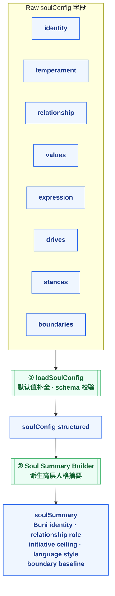
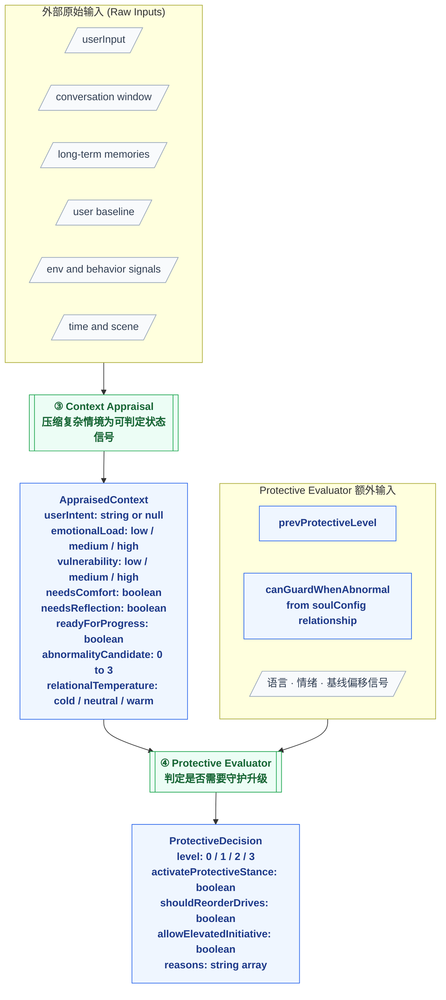
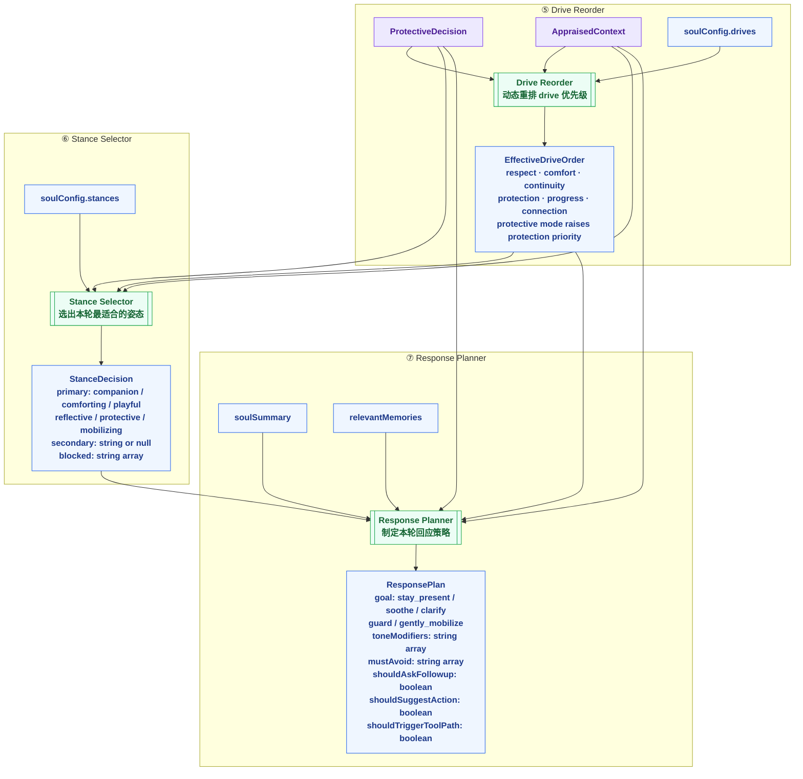
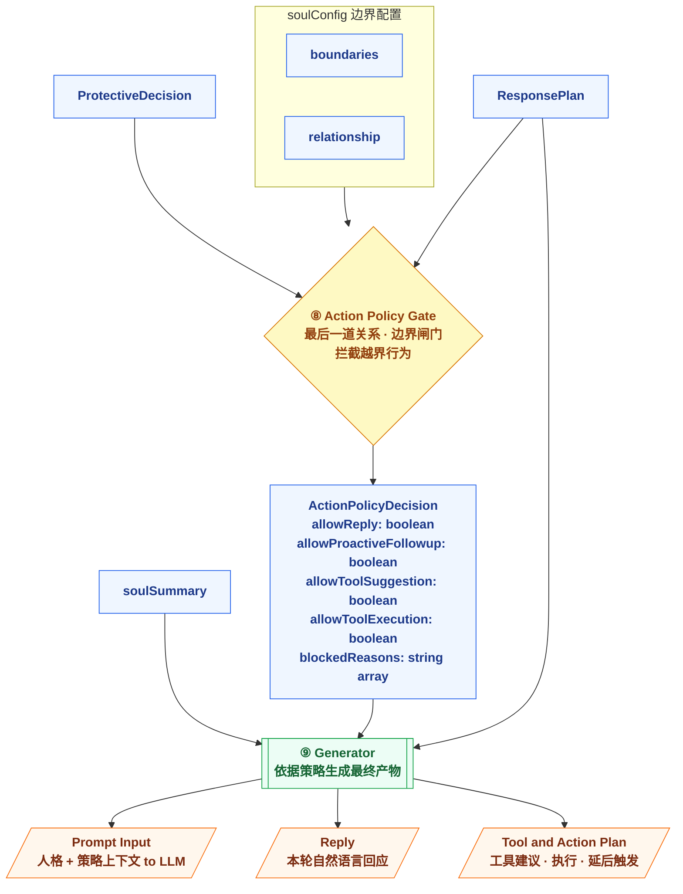
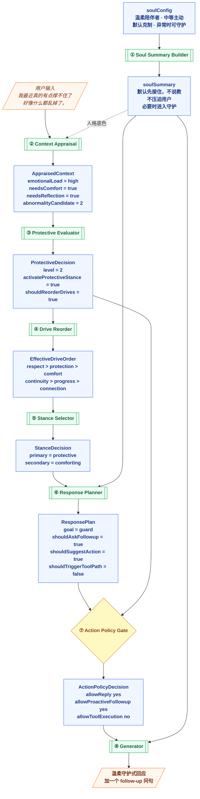

# SOUL Runtime Pipeline — 函数式数据流图

> 配套文档：[soul-runtime-pipeline.md](../soul-runtime-pipeline.md)
>
> 每张图聚焦不同层次的细节，遵循当前统一的 Mermaid 规则：用形状表达语义，用更保守的标签写法保证渲染稳定。

---

## 图例 Legend

|  形状   | 含义                | 用法                                                       |
| :-----: | ------------------- | ---------------------------------------------------------- |
| `[/ /]` | 外部输入 / 输出     | `latestUserText`、`Prompt Input`、`Reply`                  |
|  `[ ]`  | 数据 / Contract     | `SoulSummary`、`ProtectiveDecision`、`ResponsePlan`        |
| `[[ ]]` | 纯函数              | `buildSoulSummary`、`appraiseContext`、`buildResponsePlan` |
|  `{ }`  | Gate / 决策         | `Action Policy Gate`                                       |
| `(( ))` | 事件 / side-channel | observability signal、fallback signal                      |

说明：

- `Runtime` 的复杂度优先通过 `subgraph` / lane 表达，而不是再引入单独的“runtime 节点”
- 节点文本统一避免使用容易触发 Mermaid 歧义解析的 `||`、字面量 `\n`、以及节点内部的 `|`

---

## Chart 1: Pipeline 总览 (Linear Overview)

左 → 右展示完整 8 阶段主链路，直观呈现**时序**与**层次**。

```mermaid
%%{init: {'theme': 'base', 'themeVariables': {'fontSize': '14px', 'lineColor': '#94a3b8'}}}%%
flowchart LR
    classDef ext fill:#fff7ed,stroke:#f97316,color:#7c2d12,font-weight:bold
    classDef data fill:#eff6ff,stroke:#2563eb,color:#1e3a8a,font-weight:bold
    classDef fn fill:#ecfdf5,stroke:#16a34a,color:#166534,font-weight:bold
    classDef gate fill:#fef3c7,stroke:#d97706,color:#92400e,font-weight:bold

    SC[soulConfig]:::data
    SB[[Soul Summary Builder]]:::fn
    SS[soulSummary]:::data

    CTX[/userInput<br/>conversation<br/>memories<br/>env signals/]:::ext
    CA[[Context Appraisal]]:::fn
    AC[AppraisedContext]:::data

    PE[[Protective Evaluator]]:::fn
    PD[ProtectiveDecision]:::data

    DR[[Drive Reorder]]:::fn
    EDO[EffectiveDriveOrder]:::data

    STS[[Stance Selector]]:::fn
    STD[StanceDecision]:::data

    RP[[Response Planner]]:::fn
    RPL[ResponsePlan]:::data

    APG{Action Policy Gate}:::gate
    APD[ActionPolicyDecision]:::data

    GEN[[Generator]]:::fn
    OUT[/Prompt Input<br/>Reply<br/>Tool Plan/]:::ext

    SC --> SB --> SS
    CTX --> CA --> AC
    AC --> PE --> PD
    PD --> DR --> EDO
    EDO --> STS --> STD
    SS & STD --> RP --> RPL
    RPL & PD --> APG --> APD
    APD & SS --> GEN --> OUT
```

---

## Chart 2: Phase 1–2 SOUL Layer — 人格底板

`soulConfig` 各字段 → `loadSoulConfig` → `Soul Summary Builder` → `soulSummary`

> `soulSummary` 只负责**稳定人格底色**，不决定当前 stance。  
> `drives` / `stances` / `boundaries` 字段将在后续阶段被分别取用。

---

## Chart 3: Phase 3–4 Context & Guard Layer — 情境感知 + 守护判定

外部原始输入 → `Context Appraisal` → `AppraisedContext` → `Protective Evaluator` → `ProtectiveDecision`

---

## Chart 4: Phase 5–7 Decision Layer — 策略决策三连

`ProtectiveDecision` + `AppraisedContext` 作为共同驱动，串联 Drive Reorder → Stance Selector → Response Planner。

---

## Chart 5: Phase 8–9 Gate & Output — 边界闸门 + 最终输出

`ResponsePlan` 经过最后一道边界检查，才能生成三类产物。

---

## Chart 6: 完整例子数据流 (Example Walk-through)

用户输入 `"我最近真的有点撑不住了，好像什么都乱掉了。"` — 数据如何流过整个 pipeline。

