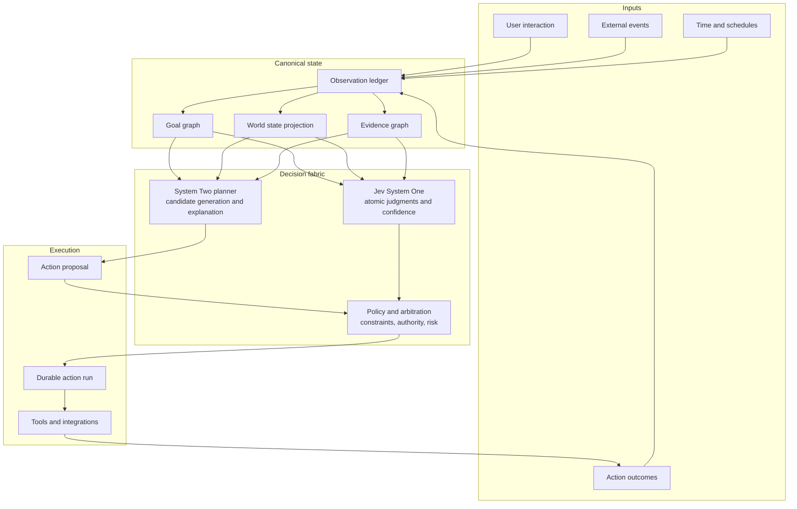
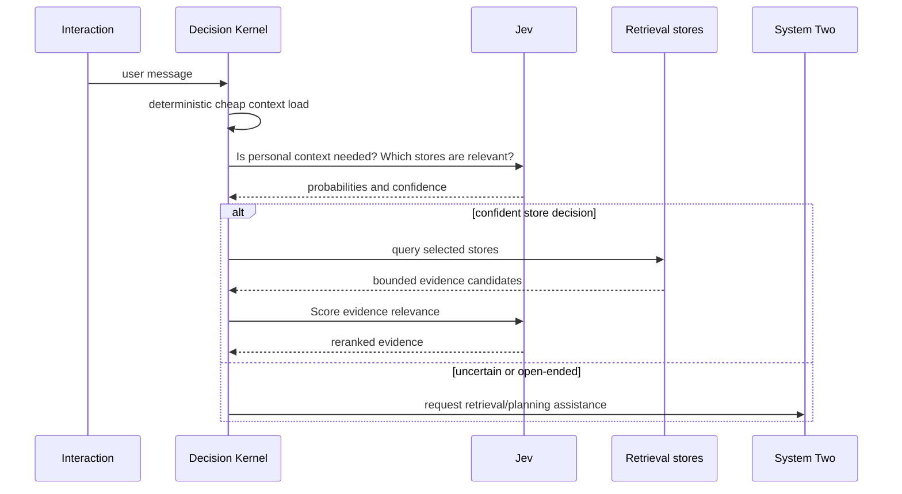
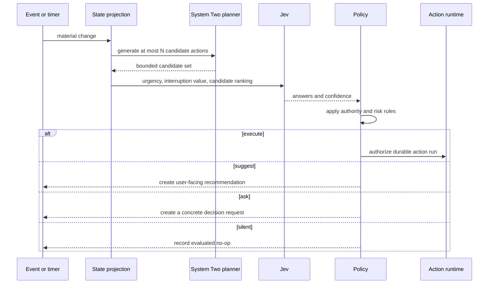

# Buni Decision OS V1

> Status: Proposed target architecture
> Date: 2026-10-21
> Scope: Product and runtime foundation before implementation
> Companion architecture: [`../../ARCHITECTURE.md`](../../ARCHITECTURE.md)
> Existing runtime plan: [`../runtime-kernel-implementation-plan.md`](../runtime-kernel-implementation-plan.md)
> TypeSafe Jev reference: <https://docs.typesafe.ai/introduction>

## 1. Decision

Buni will evolve from a chat-centered assistant with memory and tools into a **goal-centered personal Agent Operating System**.

Its role is to maintain a shared understanding of the user's goals, constraints, commitments, and evidence; identify meaningful opportunities to help; recommend or execute authorized actions; and learn from the results.

Buni will use a layered decision system:

- **deterministic code** owns truth, arithmetic, state transitions, authorization, risk limits, idempotency, and execution;
- **TypeSafe Jev** is the default System One provider for narrow semantic judgments over bounded choices;
- **a generative System Two model** understands open-ended requests, generates plans and candidate actions, performs extended reasoning, and explains decisions;
- **the user** owns goal selection, values, autonomy policy, and any action outside the granted authority.

Jev is therefore a foundation of Buni's decision fabric, but never the sole authority for consequential action.

## 2. Product Thesis

The product is not a model that happens to remember. It is a persistent partner around the user's intended outcomes.

For every material intervention, Buni must be able to answer:

1. What goal or commitment does this relate to?
2. Which facts and evidence changed the situation?
3. What candidate actions were considered?
4. Which judgment and policy selected the result?
5. Why is Buni allowed to take, suggest, or defer this action?
6. What happened after the decision?

This creates a system that can be active without being arbitrary.

### 2.1 User-visible role

Buni acts as:

| Role          | User value                        | Runtime responsibility                                          |
| ------------- | --------------------------------- | --------------------------------------------------------------- |
| Memory keeper | Preserves durable context         | Facts, episodes, commitments, evidence provenance               |
| Collaborator  | Clarifies outcomes and trade-offs | Planning, option generation, explanations                       |
| Operator      | Moves authorized work forward     | Durable action runs, checkpoints, retries                       |
| Reflector     | Improves future collaboration     | Outcome evaluation, preference updates, calibrated intervention |

### 2.2 Product invariants

1. A chat message is an interaction, not the durable unit of user intent.
2. A memory is evidence or context, not the universal owner of goals and tasks.
3. A completed action run is not proof that an external side effect succeeded; delivery and receipt need their own evidence.
4. A probability is not permission.
5. A model's confidence is not a substitute for product policy.
6. The agent must prefer silence over low-value interruption.
7. Every execution path must be reconstructable from stored state and immutable decision traces.

## 3. Target Architecture



The chat runtime becomes one interaction surface over this system. A scheduled run, an inbound message, a tool completion, and a user opening the Now screen all enter the same decision fabric.

## 4. Decision Authority Model

The architecture has four distinct authorities. They must not collapse into one prompt.

| Authority    | Question answered                                      | Owner                           | Examples                                                                 |
| ------------ | ------------------------------------------------------ | ------------------------------- | ------------------------------------------------------------------------ |
| Truth        | What is objectively recorded or computable?            | Database and deterministic code | Is the schedule overdue? Did the API return 200? Is a task already done? |
| Policy       | What is permitted or required?                         | Product policy and user grants  | May Buni send a message? Does this need confirmation?                    |
| Judgment     | What does unstructured evidence most likely mean?      | Jev                             | Is this memory relevant? Is interruption worthwhile?                     |
| Deliberation | What outcomes and possible paths should be considered? | System Two and user             | How should this project be approached? What are viable next actions?     |

The decision order is fixed:

```text
truth -> hard policy vetoes -> candidate generation -> semantic judgments -> policy composition -> action route
```

No model can reverse a hard policy veto. No heuristic or model output may directly call an effectful tool without an `ActionAuthorization` produced by policy.

## 5. Canonical Domain Model

All persistence and runtime contracts will be Zod-schema-first. TypeScript types are inferred from schemas. These names describe the target vocabulary; V1 implementation can introduce them incrementally.

### 5.1 Goal graph

A goal is an intended outcome, not merely a text task.

```ts
type Goal = {
  id: string;
  profileId: string;
  title: string;
  desiredOutcome: string;
  status: "draft" | "active" | "blocked" | "paused" | "completed" | "abandoned";
  horizon: "today" | "week" | "project" | "ongoing";
  successCriteria: SuccessCriterion[];
  constraints: GoalConstraint[];
  autonomyPolicyId: string;
  planVersion: number;
  nextReviewAt: string | null;
  createdAt: string;
  updatedAt: string;
};

type Commitment = {
  id: string;
  goalId: string | null;
  kind: "task" | "promise" | "deadline" | "decision" | "dependency";
  status: "open" | "blocked" | "done" | "cancelled";
  title: string;
  dueAt: string | null;
  owner: "user" | "buni" | "external";
  evidenceIds: string[];
};
```

A `Goal` owns the purpose and evaluation context. A `Commitment` is an actionable or observable obligation inside that context. Existing task memories can be migrated into commitments only after the new model is proven; they remain evidence during the transition.

### 5.2 Evidence and world state

`WorldState` is an immutable projection assembled for a decision. It is not a permanent catch-all table.

```ts
type WorldState = {
  asOf: string;
  goal: Goal | null;
  commitments: Commitment[];
  facts: Fact[];
  evidence: Evidence[];
  schedule: ScheduleState;
  actionRuns: ActionRunSummary[];
  userContext: UserContext;
  riskSignals: RiskSignal[];
};

type Evidence = {
  id: string;
  kind: "message" | "memory" | "tool_result" | "schedule" | "document" | "external_event";
  sourceId: string;
  summary: string;
  observedAt: string;
  confidence: number | null;
  freshness: "current" | "aging" | "stale" | "unknown";
  provenance: EvidenceProvenance;
};
```

A decision receives a minimal projection. It must not receive a raw conversation dump, all memories, or unfiltered external content.

### 5.3 Decisions and actions

```ts
type Decision = {
  id: string;
  profileId: string;
  goalId: string | null;
  kind: DecisionKind;
  stateFingerprint: string;
  candidateSet: DecisionCandidate[];
  judgments: Judgment[];
  policyResult: PolicyResult;
  route: DecisionRoute;
  outcome: DecisionOutcome | null;
  createdAt: string;
};

type ActionProposal = {
  id: string;
  goalId: string | null;
  decisionId: string;
  kind: string;
  title: string;
  rationale: string;
  expectedOutcome: string;
  reversibility: "reversible" | "partially_reversible" | "irreversible";
  requiredAuthority: AuthorityLevel;
  input: Record<string, unknown>;
};

type ActionAuthorization = {
  proposalId: string;
  mode: "deny" | "suggest" | "request_confirmation" | "execute";
  grantedBy: "policy" | "user";
  constraints: ExecutionConstraint[];
  expiresAt: string | null;
};
```

## 6. Jev's Exact Role

Jev is the default implementation of semantic local judgment. It receives a carefully scoped `DecisionState` and a batch of atomic questions. It returns typed answers, probability distributions, and confidence; it does not generate plans, mutate Buni state, or execute tools.

### 6.1 Allowed Jev responsibilities

- decide whether a user request depends on personal history;
- judge relevance of retrieved evidence to a current decision;
- rank a bounded set of candidate actions;
- score interruption value and user-facing urgency;
- classify whether a situation needs System Two planning;
- judge whether a candidate explanation is grounded in its supplied evidence;
- assess whether a low-risk action is likely to advance a goal.

### 6.2 Disallowed Jev responsibilities

- calculate time, count records, compare dates, or enforce database invariants;
- generate a goal, plan, action input, message, or permission grant;
- authorize messages, purchases, deletion, credentials, or other consequential effects;
- consume unbounded raw history or arbitrary external content;
- decide a high-risk action without policy and explicit user authority.

### 6.3 Question catalogue

A question must have a stable ID, owner, state projection, decision intent, criteria, expected risk, and offline evaluation set.

| Question family                 | Primitive | State projection                    | Code consumer      |
| ------------------------------- | --------- | ----------------------------------- | ------------------ |
| `retrieval.relevance`           | Score     | user need + retrieved item          | retrieval reranker |
| `retrieval.store_activation`    | Noul      | latest request + store summary      | retrieval planner  |
| `initiative.interruption_value` | Score     | goal health + user context + change | initiative policy  |
| `initiative.best_candidate`     | Choice    | goal + bounded proposals            | candidate selector |
| `planning.requires_system_two`  | Noul      | request + unresolved decision       | model router       |
| `execution.goal_progress`       | Score     | action outcome + success criteria   | outcome evaluator  |
| `expression.evidence_support`   | Noul      | draft claim + citations             | response guard     |

Questions must be atomic. For example, do not ask “Should Buni proactively execute the best action?” Split it into:

1. Is the goal materially at risk?
2. Is an interruption worthwhile now?
3. Which candidate most advances the goal?
4. Is that candidate semantically reversible?
5. Does current evidence support it?

Code then combines these results with authority and risk policy.

### 6.4 Provider contract

Buni owns a provider-neutral interface. TypeSafe SDK types stay inside the adapter.

```ts
type DecisionProvider = {
  id: string;
  decide(input: DecisionRequest): Promise<DecisionProviderResult>;
};

type DecisionProviderResult = {
  providerId: string;
  providerVersion: string;
  answers: Record<string, DecisionAnswer>;
  usage: DecisionUsage;
};

type DecisionAnswer = {
  questionId: string;
  kind: "choice" | "score" | "noul";
  selectedValue: string | number | boolean;
  probabilities: Record<string, number>;
  confidence: number | null;
};
```

The target provider order is not a democratic vote between models. It is a routing hierarchy:

```text
Deterministic policy
  -> Jev for bounded semantic judgment
  -> System Two only for unresolved or open-ended deliberation
  -> User when authority or values are required
```

`HeuristicDecisionProvider` remains during migration as a baseline and fallback, not as the desired long-term semantic layer.

## 7. Policy and Autonomy

Jev's probability answers whether a proposition is likely. Policy decides what Buni may do about it.

### 7.1 Autonomy modes

| Mode                 | Buni may do                                 | Buni must not do                                           |
| -------------------- | ------------------------------------------- | ---------------------------------------------------------- |
| `observe`            | Track, summarize, surface changes           | Interrupt or act without a direct request                  |
| `collaborate`        | Suggest plans and decisions                 | Execute external changes                                   |
| `execute_reversible` | Complete pre-authorized, reversible actions | Send external communications or irreversible changes       |
| `delegate`           | Run pre-approved workflows with checkpoints | Exceed granted scope, budget, destinations, or time window |

Autonomy is scoped to a goal, tool family, destination, budget, and time window. It is never a global boolean such as “agent mode on.”

### 7.2 Action route

```ts
const decideRoute = (input: {
  hardPolicy: HardPolicyResult;
  authority: AuthorityResult;
  confidence: number;
  interruptionValue: number;
  reversibility: Reversibility;
}): DecisionRoute => {
  if (!input.hardPolicy.permitted) return "deny";
  if (!input.authority.granted) return "request_confirmation";
  if (input.confidence < 0.8) return "use_system_two";
  if (input.interruptionValue < 0.55) return "stay_silent";
  return input.reversibility === "reversible" ? "execute" : "suggest";
};
```

The numbers above are illustrative. Production thresholds are versioned policy values calibrated against Buni outcomes, not constants embedded in a provider adapter.

### 7.3 Policy precedence

1. Legal, security, and data-handling constraints
2. Explicit user instruction for this action
3. Goal autonomy policy and scoped grants
4. Product risk policy
5. Jev confidence and semantic results
6. Convenience and latency preferences

## 8. End-to-End Decision Flows

### 8.1 Memory and retrieval



The existing memory gate and retrieval plan become transitional implementations of this flow. Temporal, graph, and knowledge stores remain; only their activation and reranking judgment changes.

### 8.2 Proactive goal assistance



A no-op is an outcome worth recording. It prevents repeated re-evaluation from becoming noisy or spammy.

### 8.3 Outcome evaluation

Every action creates a follow-up decision after an appropriate observation window:

- did the action run complete?
- did the intended external effect occur?
- did it advance the goal's success criteria?
- did the user accept, modify, ignore, or reverse it?
- should the plan, policy threshold, or autonomy scope change?

## 9. Runtime Boundaries

### 9.1 Functional core

`packages/core` owns pure functions:

```text
packages/core/src/decision/
  build-world-state.ts
  build-decision-request.ts
  compile-jev-questions.ts
  compose-judgments.ts
  evaluate-policy.ts
  select-action-route.ts
  evaluate-outcome.ts
```

These functions accept plain validated data and return plain validated data. They do not perform HTTP, persistence, clock reads, or provider calls.

### 9.2 Imperative shell

`apps/server` owns effects:

```text
apps/server/src/decision/
  load-world-state.ts
  providers/openrouter-jev-provider.ts
  providers/heuristic-decision-provider.ts
  decision-service.ts
  decision-observer.ts
  action-authorization-service.ts

apps/server/src/actions/
  action-run-service.ts
  action-worker.ts
  action-tool-adapter.ts
```

The shell loads state, invokes Jev or System Two, persists decision traces, authorizes effects, and schedules durable action runs.

### 9.3 Existing Buni modules

| Current area                                    | Target role                                                             |
| ----------------------------------------------- | ----------------------------------------------------------------------- |
| `packages/core/src/cognition/memory-gate.ts`    | transitional retrieval decision baseline                                |
| `packages/core/src/cognition/retrieval-plan.ts` | deterministic query construction after semantic activation              |
| `packages/core/src/cognition/working-memory.ts` | decision-state projection input, no longer final action selector        |
| `packages/core/src/soul/*`                      | user-facing stance and expression policy, downstream from action policy |
| `apps/server/src/runtime/run-retrieval.ts`      | retrieval executor and evidence collector                               |
| `apps/server/src/task-runs/*`                   | starting substrate for durable action runs                              |
| `apps/server/src/tools/*`                       | tool implementations behind action authorization                        |
| `runtime_turns` and `runtime_spans`             | compatibility observability; decision traces become first-class         |

## 10. Persistence and Observability

The target adds append-only decision evidence. Mutable projections can be rebuilt from it.

### 10.1 Tables

| Table                   | Purpose                                                    |
| ----------------------- | ---------------------------------------------------------- |
| `goals`                 | Current goal state and policy binding                      |
| `commitments`           | Tasks, deadlines, dependencies, and decisions              |
| `goal_evidence`         | Links goals to source evidence                             |
| `decisions`             | Immutable decision header and final route                  |
| `decision_candidates`   | Considered plans or actions                                |
| `decision_judgments`    | Jev questions, answers, probabilities, confidence, version |
| `action_proposals`      | Candidate effectful work                                   |
| `action_authorizations` | Policy/user grants and expiry                              |
| `action_runs`           | Durable execution lifecycle                                |
| `decision_outcomes`     | Evaluation and user feedback                               |

`action_runs` is the decision-owned durable execution substrate. Scheduled `task_runs` remain a legacy/runtime compatibility path while their schedule-specific fields are mapped into action-run inputs. The target remains one substrate; no new decision-family execution may bypass authorization or create another worker shape.

### 10.2 Trace requirements

Every material decision records:

- goal and trigger;
- sanitized state fingerprint and referenced evidence IDs;
- candidate IDs and deterministic eligibility filters;
- question IDs, criteria version, provider/model version, probabilities, confidence, latency, and cost;
- policy version and route;
- authorization source;
- action run and outcome references.

Raw user content should not be copied into traces by default. Evidence references and redacted summaries are sufficient for most debugging.

### 10.3 New runtime stages

The current runtime stages should eventually add:

```text
goal_context_load
world_state_build
candidate_generation
decision_question_compile
system_one_judgment
policy_arbitration
action_authorization
action_enqueue
decision_outcome_evaluate
```

Existing `retrieval_plan`, `working_memory_build`, `soul_decision`, and `tool_call` remain useful, but they become visible sub-stages of a broader decision trace.

## 11. Evaluation

Do not use vendor benchmark claims as Buni's acceptance criteria. Build Buni-specific datasets from replayable, consented decision traces.

### 11.1 Offline sets

| Set                 | Label                               | Primary metric                               |
| ------------------- | ----------------------------------- | -------------------------------------------- |
| Retrieval routing   | relevant stores and evidence        | recall at budget, unnecessary retrieval rate |
| Initiative          | whether interruption was worthwhile | acceptance rate, nuisance rate               |
| Candidate selection | best next action among candidates   | agreement with reviewed label, goal progress |
| Escalation          | whether System Two was needed       | missed-complexity rate, excess-cost rate     |
| Outcome evaluation  | did action advance goal?            | agreement with user/result evidence          |
| Chinese robustness  | same decision across Chinese inputs | accuracy and confidence calibration          |

### 11.2 Online metrics

- user acceptance, dismissal, edit, and reversal rate;
- interventions per active goal and per day;
- goal progress and completion rate;
- action execution success, delivery confirmation, and retry rate;
- high-confidence error rate;
- policy denial and confirmation rate;
- Jev latency, cost, version, and fallback rate;
- drift between shadow provider and active provider.

### 11.3 Release gates

A Jev decision family cannot control user-visible proactive behavior until it has:

1. a versioned question and criteria contract;
2. a baseline heuristic or reviewed-label comparison;
3. Chinese test examples when Chinese input is supported;
4. calibrated thresholds for its risk tier;
5. a shadow period with decision traces;
6. a deterministic fallback;
7. an owner and rollback procedure.

## 12. Threat Model and Data Boundaries

Jev sees data sent to an external provider. Buni must minimize and sanitize that state.

1. Send decision-specific projections, not full raw history.
2. Never send credentials, tokens, private keys, or unnecessary personal identifiers.
3. Treat retrieved web pages, tool output, and user-authored documents as untrusted data, not instructions.
4. Label state fields semantically and write questions that reference exact fields.
5. Use fixed model IDs, not moving aliases, once thresholds are calibrated.
6. Test Choice questions with option-order permutations where a ranking controls an important outcome.
7. Use deterministic code for dates, arithmetic, counting, budgets, and permissions.
8. Establish data-processing and retention requirements before production credentials are enabled.

## 13. Migration Plan

### Phase A: Decision vocabulary and trace, no behavior change

- add contracts for goals, commitments, decisions, candidates, judgments, and policy results;
- introduce append-only decision traces;
- wrap existing memory heuristics as `HeuristicDecisionProvider`;
- make current decision reasons observable without changing outcome.

**Exit condition:** Existing chat and task paths produce replayable decision traces.

### Phase B: Jev shadow mode

- implement `TypeSafeJevDecisionProvider` behind the provider-neutral contract;
- add a question catalogue for retrieval activation and initiative;
- run Jev beside heuristics with no effect on routing;
- build reviewed examples from divergences and user outcomes.

**Exit condition:** A Buni-specific evaluation report exists for the first two decision families.

### Phase C: Low-risk active routing

- enable Jev for retrieval reranking and System Two escalation only;
- keep hard policy and heuristic fallback in place;
- use fixed model versions and feature flags.

**Exit condition:** Lower unnecessary retrieval or model cost without regressing answer quality.

### Phase D: Goal-centric initiative

- persist goals and commitments;
- implement candidate generation and initiative policy;
- enable proactive suggestions for one low-risk goal type;
- add a Now view that exposes active goals, pending decisions, and evaluated no-ops.

**Exit condition:** Users can inspect why Buni suggested an action and can tune its autonomy per goal.

### Phase E: Authorized durable execution

- unify scheduled task execution and action runs;
- add scoped authorization, checkpoints, cancellation, and outcome evaluation;
- permit only reversible, explicitly authorized action classes first.

**Exit condition:** An action can survive chat disconnects, report its outcome, and prove its authorization.

## 14. Explicit Non-Goals for V1

- fully autonomous open-ended work without a goal, scope, or review point;
- online fine-tuning of Jev from raw user interactions;
- replacing all deterministic rules with model judgments;
- replacing System Two planning with Jev;
- granting broad global autonomy;
- treating a completed worker run as proof of external delivery;
- silently migrating all historical memory tasks into goals.

## 15. First Vertical Slice

The first proof should be one narrow loop:

```text
User states an explicit project goal
  -> Buni creates a Goal and one Commitment
  -> a relevant state change occurs
  -> System Two creates at most three candidate next actions
  -> Jev ranks candidates and scores interruption value
  -> policy selects suggest / ask / silent
  -> user accepts one recommendation
  -> Buni records outcome and updates goal progress
```

The first slice does not execute external writes. Its success is a useful, explainable next-step suggestion with a complete decision trace.

## 16. Open Decisions

1. What first goal type has enough signal and low enough risk for the vertical slice: software project, personal reminder, or research task?
2. What data-processing agreement and account tier are acceptable for sending Buni state to TypeSafe?
3. What is the initial Chinese benchmark corpus and who reviews labels?
4. How should user-facing explanations expose probabilities without creating false precision?
5. Which existing `task_runs` fields map directly to the future `action_runs` contract?
6. Should a goal require explicit creation, or may Buni propose a draft goal from a conversation?

## 17. Source References

- TypeSafe, [Introduction](https://docs.typesafe.ai/introduction): typed System One questions over state.
- TypeSafe, [How to build with System One](https://docs.typesafe.ai/concepts/how-to-build-with-system-one): keep control flow and effects in code; use atomic questions and confidence-gated routing.
- TypeSafe, [Models](https://docs.typesafe.ai/models): Jev model versions, context limits, language and data-handling notes.
- TypeSafe, [Jev 1.13 jaggedness](https://docs.typesafe.ai/model-jaggedness/jev-1.13): known limits around literalness, numeric reasoning, date arithmetic, irrelevant context, adversarial content, and Choice order.
