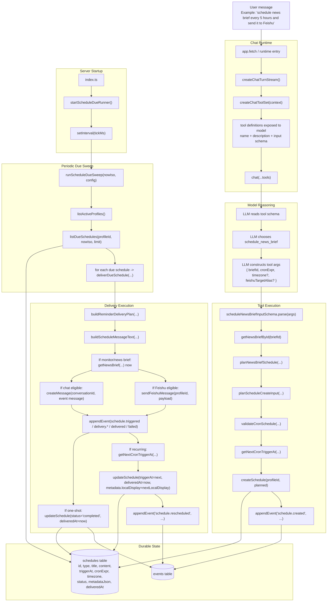
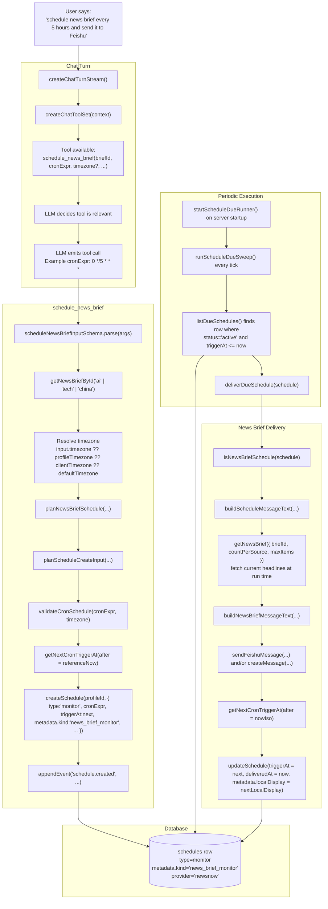

# Buni Schedule Runtime Dataflow V1

> Status: implemented
> Date: 2026-05-30
> Companion docs:
> - [./schedule-cron-recurrence-v1.md](./schedule-cron-recurrence-v1.md)
> - [./schedule-reminder-delivery-v1.md](./schedule-reminder-delivery-v1.md)
> - [./news-tools-v1.md](./news-tools-v1.md)

## Purpose

This document explains the real end-to-end schedule dataflow in Buni:

- how a user message becomes a tool call
- how the model supplies `cronExpr`
- how a schedule row is persisted
- how the due runner finds due work
- how delivery is actually executed

## Reality Check

The current runtime does **not** use a separate `task` table for schedule
execution.

The implemented chain is:

1. tool call writes or updates a row in `schedules`
2. recurring schedules persist their next due time in `triggerAt`
3. `startScheduleDueRunner()` starts a periodic in-process sweep
4. `runScheduleDueSweep()` queries the `schedules` table directly
5. `deliverDueSchedule()` performs side effects directly
6. after a recurring delivery succeeds, Buni computes and persists the next `triggerAt`

So the durable execution queue is the `schedules` table itself, not a derived
task queue.

## General End-to-End Flow

**Explanation**

- The model is not handed a hidden scheduler DSL. It sees the tool schema and must supply `cronExpr` explicitly.
- The schedule tool does not enqueue a separate job row. It writes a durable row into `schedules`.
- The server starts one periodic due runner on boot. That runner queries `schedules` directly.
- Actual side effects happen inside `deliverDueSchedule()`: chat message creation, Feishu send, event append, and recurring re-arming.
- For recurring schedules, execution and rescheduling are one loop: `deliver current run -> compute next triggerAt -> persist back to schedules`.

## Specific Flow: `schedule_news_brief`

**Explanation**

- In this specific tool, the LLM must generate `cronExpr` itself from the user intent. Buni does not currently translate a higher-level recurrence object at this boundary.
- The stored row contains only the durable scheduling truth needed for execution: `triggerAt`, `cronExpr`, `timezone`, delivery metadata, and the brief configuration.
- At execution time, Buni does **not** send a cached news payload. It fetches the current brief again with `getNewsBrief(...)`, then renders and delivers that run's headlines.
- After a successful recurring run, the same schedule row is advanced to the next `triggerAt`.

## Function Map

- Chat runtime entry: `apps/server/src/runtime/create-chat-turn-stream.ts`
- Tool registration: `apps/server/src/tools/tool-sets.ts`
- Schedule tool contract: `packages/contracts/src/execution-layer/schedule-news-brief.ts`
- Schedule tool implementation: `apps/server/src/tools/schedule-news-brief.ts`
- Core schedule planning: `apps/server/src/schedules/plan-schedule.ts`
- Cron calculation: `apps/server/src/schedules/recurrence.ts`
- Due runner startup and sweep: `apps/server/src/schedules/due-runner.ts`
- Delivery execution: `apps/server/src/schedules/delivery.ts`
- Schedule persistence: `packages/db/src/repos/schedules.ts`
- Server startup wiring: `apps/server/src/index.ts`
