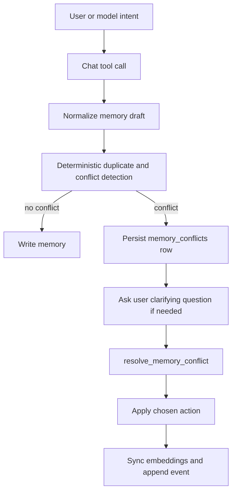

# Chat-Writable Memory Tools System Design

> Status: Active design
> Date: 2026-05-29

## Purpose

Define the architecture and runtime behavior for chat-authored memory curation.

## Tool Surface

- `save_memory`
- `update_memory`
- `resolve_memory_conflict`
- `mark_task_done`
- existing `recall_memory` remains unchanged as the read path

## Design Rules

1. Chat writes go through the canonical server chat runtime tool path.
2. The server remains the source of truth.
3. Conflict detection is deterministic and testable.
4. Conflict resolution is durable across turns.
5. Only active memories participate in active recall.

## Data Model

## `memories`

Chat writes rely on explicit memory lifecycle fields already present in the table:

- `memoryClass`
- `status`
- `sourceKind`

Status semantics in this design:

- `active`: recall-eligible durable memory
- `done`: closed task memory
- `superseded`: replaced by a newer authoritative memory
- `archived`: hidden durable memory, not in active recall

## `memory_conflicts`

New persisted artifact for deferred resolution.

Fields:

- `operation`: `save | update`
- `conflictKind`: `semantic_overlap | task_overlap`
- `status`: `open | resolved | cancelled`
- `existingMemoryId`: active memory that triggered the conflict
- `subjectMemoryId`: memory being edited, only for `update`
- `proposalJson`: normalized proposed durable memory state
- `resolutionJson`: applied action and affected memory ids

## Runtime Flow

## Write Semantics

## `save_memory`

Input intent:

- durable fact
- preference
- open task
- notable event worth future recall

Behavior:

1. Normalize the draft.
2. Infer keywords if omitted.
3. Infer default task behavior:
   `task -> unresolved: true`
4. Detect duplicates and conflicts against active memories of the same type.
5. If duplicate, return existing memory without writing.
6. If conflict, create or reuse an open `memory_conflicts` row.
7. Otherwise create a new memory with `sourceKind = chat_tool`.

## `update_memory`

Behavior:

1. Load existing memory by `memoryId`.
2. Build the proposed next state.
3. Detect whether the next state collides with another active memory.
4. If conflict exists, create or reuse a persisted conflict row.
5. Otherwise update the memory in place.

## `mark_task_done`

Behavior:

1. Load the task memory.
2. Set:
   - `unresolved = false`
   - `status = done`
3. Remove or disable active-recall embedding participation.

## Conflict Resolution Semantics

`resolve_memory_conflict` supports these actions:

- `keep_existing`
  - close the conflict without changing stored memories
- `replace_existing`
  - the proposed memory wins
  - conflicting active memory becomes `superseded` when needed
- `create_separate_memory`
  - keep both memories as separate truths
- `merge_memories`
  - apply a merged final memory payload
  - supersede the conflicting memory when needed
- `cancel`
  - cancel the pending conflict record

## Conflict Detection

Phase 1 conflict detection is deliberately deterministic.

Inputs:

- normalized content
- normalized keyword set
- memory type
- active status
- unresolved task state

Rules:

- exact content match of the same type counts as duplicate
- open task overlap counts as `task_overlap`
- overlapping active `fact` or `preference` memories count as `semantic_overlap`
- `event` and `thought` writes do not block on overlap in phase 1

## Embedding and Retrieval Behavior

Rules:

- active memories keep vector embeddings
- inactive memories do not participate in active recall
- temporal recall filters candidate ids through active memory status before surfacing
- unresolved and recent carryover queries only read active memories

## Module Boundary

Pure core:

- `packages/core/src/cognition/memory-curation.ts`
  - normalize draft
  - derive defaults
  - detect duplicates and conflicts

Imperative shell:

- `apps/server/src/tools/*`
  - tool execution
  - DB writes
  - event append
  - embedding sync

Persistence:

- `packages/db/src/schema/memory-conflicts.ts`
- `packages/db/src/repos/memory-conflicts.ts`
- `packages/db/src/repos/memories.ts`

Contracts:

- `packages/contracts/src/execution-layer/*`

## Verification

Minimum verification for this feature:

1. Unit tests for pure conflict detection.
2. Typecheck across `contracts`, `core`, `db`, and `server`.
3. Manual or automated confirmation that the chat tool set now includes the four write tools.

## Refactor Note

AGGRESSIVE REFACTOR:

We are intentionally using explicit status transitions and a new conflict artifact now rather than layering hacks on top of recall-only memory. This is the cleaner long-term boundary for chat-authored memory curation.
