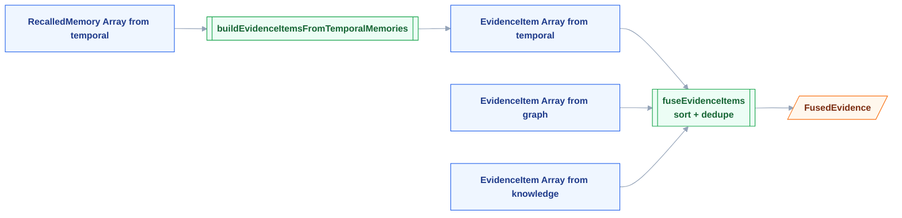
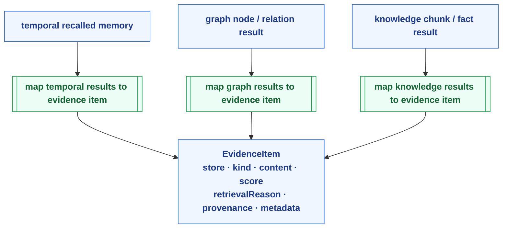
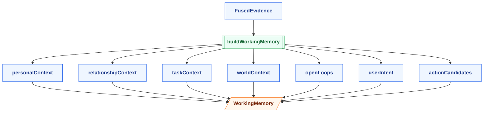
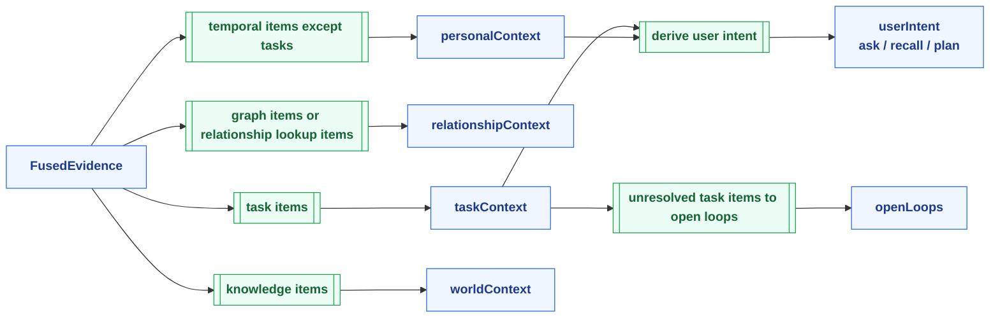

# Evidence Fusion & Working Memory — 分层图

> 配套文档：[current-memory-system-qa.md](../current-memory-system-qa.md)

---

## 图例 Legend

|  形状   | 含义                               | 用法                                  |
| :-----: | ---------------------------------- | ------------------------------------- |
| `[/ /]` | 最终输出 / runtime-facing artifact | `FusedEvidence`、`WorkingMemory`      |
|  `[ ]`  | 数据 / schema                      | `EvidenceItem`、`taskContext`         |
| `[[ ]]` | 纯函数                             | normalize、fuse、build working memory |

---

## Chart 1: Evidence Fusion

---

## Chart 2: EvidenceItem Contract Normalization

---

## Chart 3: Working Memory Build

---

## Chart 4: Bucket Semantics

