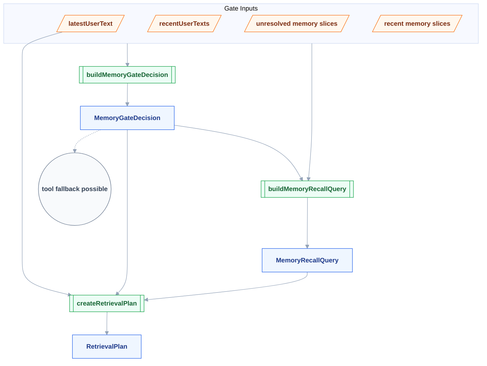
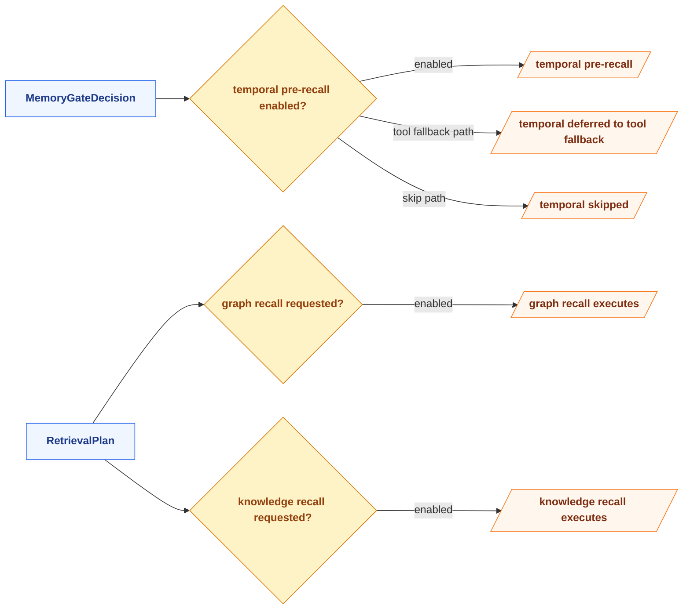
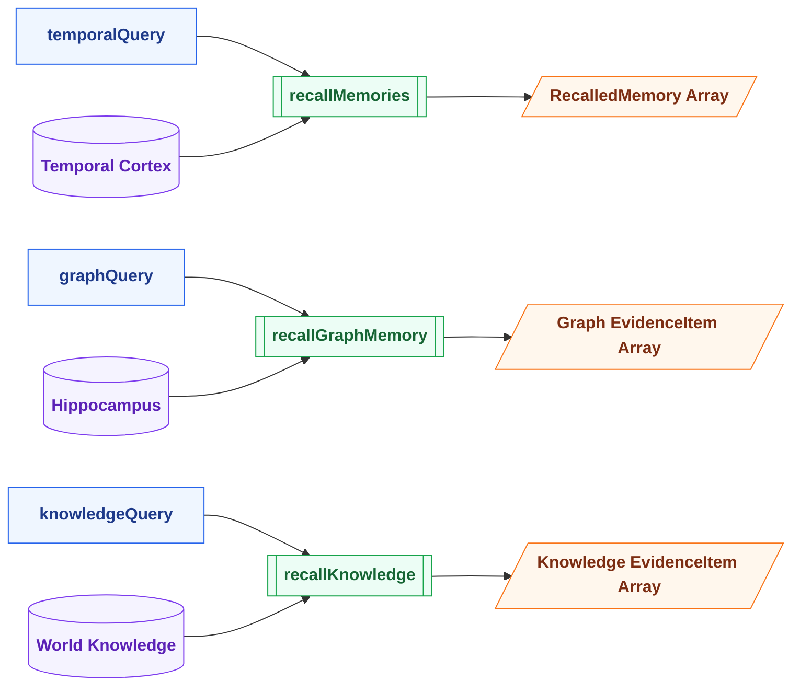

# Memory Retrieval Pipeline — 函数式数据流图

> 配套文档：[current-memory-system-qa.md](../current-memory-system-qa.md)

---

## 图例 Legend

| 形状 | 含义 | 用法 |
|:----:|------|------|
| `[/ /]` | 外部输入 / 输出 | `latestUserText`、`query` |
| `[ ]` | 数据 / Contract | `MemoryGateDecision`、`MemoryRecallQuery`、`RetrievalPlan` |
| `[[ ]]` | 纯函数 | gate、query builder、planner |
| `{ }` | 决策 / activation | `pre_recall?`、`graph enabled?` |
| `[( )]` | Store / IO | recall stores |
| `(( ))` | Signal / Event | fallback、observability signal |

---

## Chart 1: Gate → Query → Plan

---

## Chart 2: Store Activation Logic

---

## Chart 3: Detailed Recall Execution

