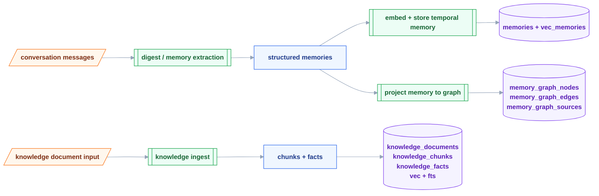
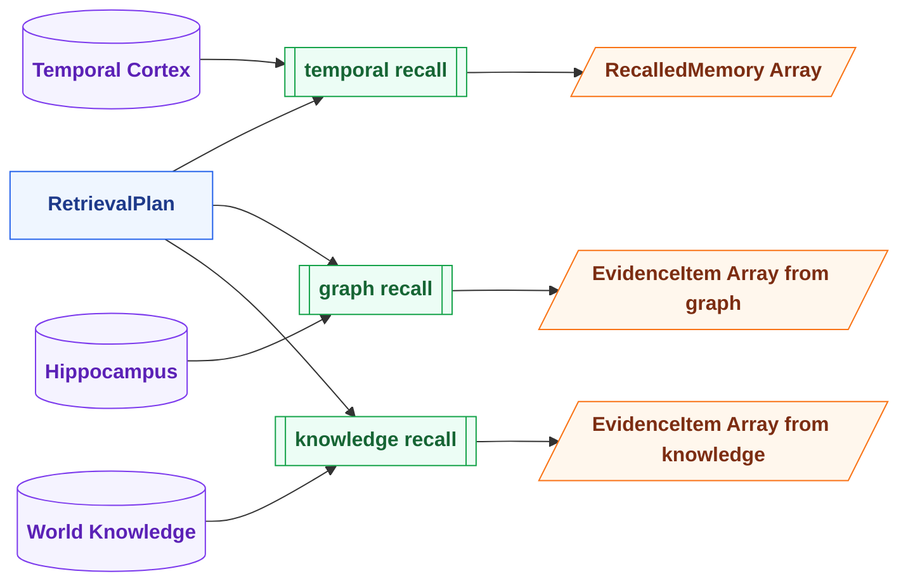
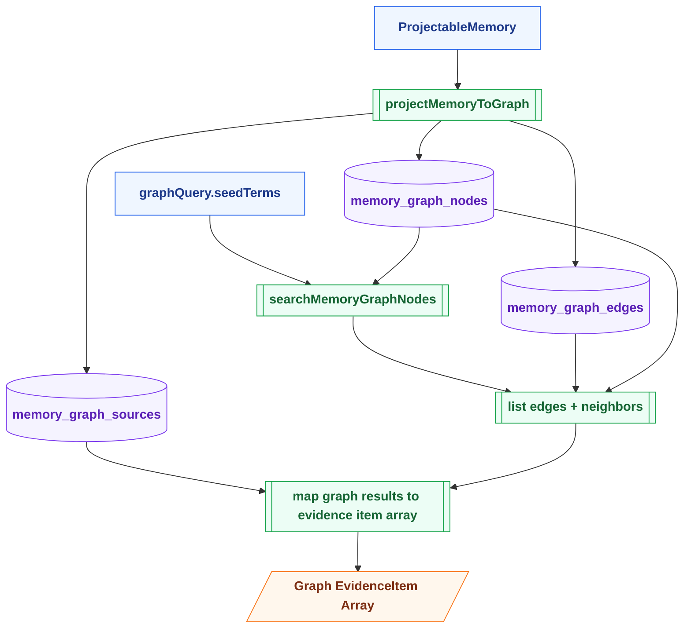
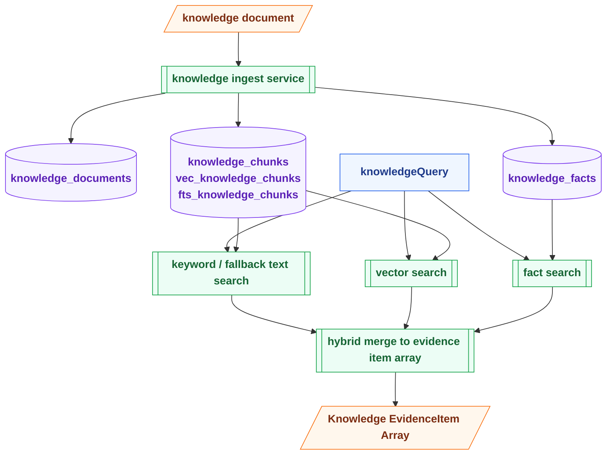

# Memory Store Boundaries — 三层记忆边界图

> 配套文档：[memory-system-v2.md](../memory-system-v2.md)

---

## 图例 Legend

|  形状   | 含义                | 用法                                 |
| :-----: | ------------------- | ------------------------------------ |
| `[/ /]` | 外部输入 / 外部产物 | messages、documents、evidence output |
|  `[ ]`  | 数据 / 中间契约     | `ProjectableMemory`、`GraphQuery`    |
| `[[ ]]` | 变换 / 提取函数     | digest、projection、ingest、search   |
| `[( )]` | Store / Index / DB  | tables、vec、fts                     |

---

## Chart 1: Write Path — Digest / Projection / Ingest

---

## Chart 2: Read Path — Three Parallel Recall Stores

---

## Chart 3: Hippocampus Internal Shape

---

## Chart 4: World Knowledge Internal Shape

