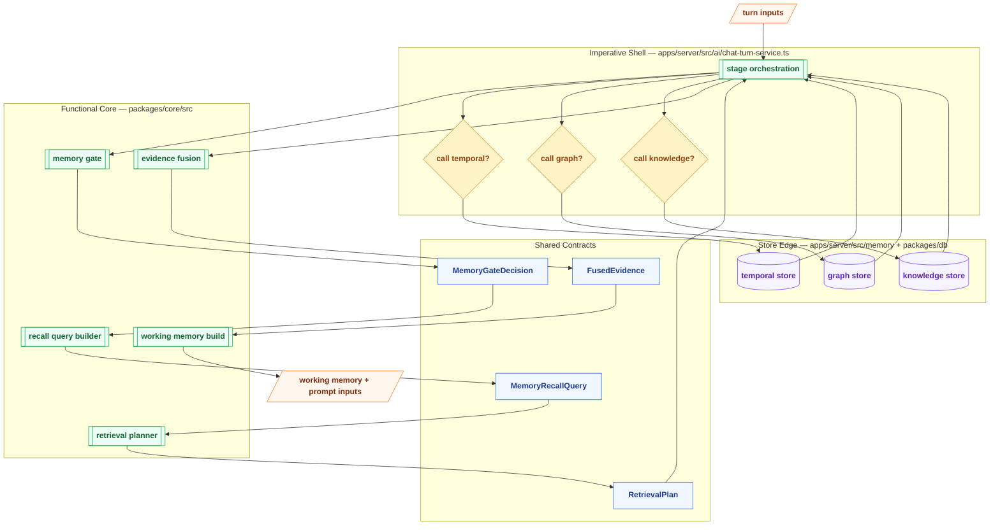

# Memory System — 分层总览图

> 配套文档：[current-memory-system-qa.md](../current-memory-system-qa.md)

---

## 图例 Legend

|  形状   | 含义                  | 用法                                                   |
| :-----: | --------------------- | ------------------------------------------------------ |
| `[/ /]` | 外部输入 / 外部输出   | `latestUserText`、`Provider Prompt`、`Reply`           |
|  `[ ]`  | 数据 Data / Contract  | `MemoryGateDecision`、`RetrievalPlan`、`WorkingMemory` |
| `[[ ]]` | 纯函数 Pure Function  | `buildMemoryGateDecision`、`fuseEvidenceItems`         |
|  `{ }`  | 决策 / Gate / Planner | `shouldPreRecall?`、`stores enabled?`                  |
| `[( )]` | Store / DB / IO       | `Temporal Cortex`、`Hippocampus`、`World Knowledge`    |
| `(( ))` | 事件 / 信号           | `tool fallback available`、`turn started`              |

说明：

- `Runtime` 不再画成单节点，而是用 `subgraph` / lane 表达 orchestration 边界
- 箭头默认表示主数据流
- `-.->` 表示 observability / side-channel / provenance 这类非主数据流

---

## Chart 1: Full Layered Overview

```mermaid
%%{init: {'theme': 'base', 'themeVariables': {'fontSize': '14px', 'lineColor': '#94a3b8'}}}%%
flowchart LR
    classDef ext fill:#fff7ed,stroke:#f97316,color:#7c2d12,font-weight:bold
    classDef data fill:#eff6ff,stroke:#2563eb,color:#1e3a8a,font-weight:bold
    classDef fn fill:#ecfdf5,stroke:#16a34a,color:#166534,font-weight:bold
    classDef gate fill:#fef3c7,stroke:#d97706,color:#92400e,font-weight:bold
    classDef store fill:#f5f3ff,stroke:#7c3aed,color:#5b21b6,font-weight:bold
    classDef event fill:#f8fafc,stroke:#64748b,color:#334155,font-weight:bold

    subgraph INPUT["External Boundary"]
        U[/latestUserText/]:::ext
        RU[/recentUserTexts/]:::ext
        UM[/unresolved memory slices/]:::ext
        RM[/recent memory slices/]:::ext
    end

    subgraph RUNTIME["Runtime Shell — orchestration & stage ordering"]
        MG[[buildMemoryGateDecision]]:::fn
        GD[MemoryGateDecision]:::data
        MQ[[buildMemoryRecallQuery]]:::fn
        RQ[MemoryRecallQuery]:::data
        RP[[createRetrievalPlan]]:::fn
        PLAN[RetrievalPlan]:::data
        TG{temporal pre-recall?}:::gate
        SIG((tool fallback available)):::event
    end

    subgraph STORES["Store / IO"]
        T[(Temporal Cortex<br/>memories + vec_memories)]:::store
        H[(Hippocampus<br/>memory_graph_*)]:::store
        K[(World Knowledge<br/>knowledge_* + vec/fts)]:::store
    end

    subgraph CORE["Functional Core — evidence normalization & reasoning prep"]
        TM[RecalledMemory Array]:::data
        GE[Graph EvidenceItem Array]:::data
        KE[Knowledge EvidenceItem Array]:::data
        EF[[fuseEvidenceItems]]:::fn
        FE[FusedEvidence]:::data
        WM[[buildWorkingMemory]]:::fn
        WMD[WorkingMemory]:::data
    end

    subgraph OUTPUT["Runtime Outputs"]
        SR[/SOUL Runtime Input/]:::ext
        PB[/Prompt Build Input/]:::ext
        PS[/Provider Stream/]:::ext
    end

    U & RU & UM & RM --> MG --> GD
    U & RU & UM & RM & GD --> MQ --> RQ
    U & GD & RQ --> RP --> PLAN
    GD -.-> SIG

    PLAN --> TG
    TG -->|enabled| T
    PLAN --> H
    PLAN --> K

    T --> TM
    H --> GE
    K --> KE

    TM & GE & KE --> EF --> FE --> WM --> WMD
    WMD --> SR --> PB --> PS
```

---

## Chart 2: Runtime Shell vs Functional Core vs Store Edge

这张图专门强调 functional paradigm 的边界。

