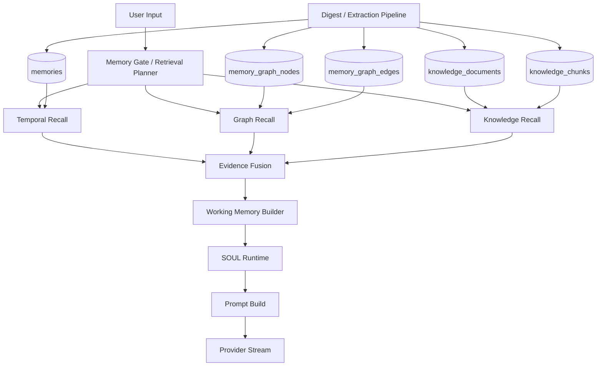

# Buni V2 多层记忆系统设计

> 版本：1.0  
> 日期：2026-04-30

---

## 0. 目的

这份文档定义 Buni 下一阶段的记忆系统升级方案。

当前系统已经具备一层稳定的长期记忆：

- `Temporal Cortex`
- `memories` + `vec_memories`
- digest / embedding / recall

但它本质上仍然是一套“向量相似召回系统”，还不是一套完整的认知记忆架构。

这次升级的目标是把 Buni 的记忆系统拆成四层：

1. `Temporal Cortex`
   负责“像不像”
2. `Hippocampus`
   负责“谁和谁、什么时候、发生了什么、后来怎样”
3. `World Knowledge`
   负责“Agent 学到的通用知识与领域知识”
4. `Prefrontal Cortex`
   负责“把证据变成 working memory、计划和行动”

---

## 配套文档

- [memories-implementation.md](./memories-implementation.md)
- [memory-recall-redesign.md](./memory-recall-redesign.md)
- [core-layer/soul-runtime-observability.md](../core-layer/soul-runtime-observability.md)

---

## 1. 当前基线

当前仓库里已经存在的基础能力：

- `apps/server/src/ai/recall-pipeline.ts`
  - query embedding
  - sqlite-vec KNN
  - `vector + keyword + importance` 排序
  - unresolved / recent surfacing
- `apps/server/src/ai/digest-pipeline.ts`
  - 从对话提炼记忆
- `packages/db/src/schema/memories.ts`
  - 当前长期记忆主表
- `apps/server/src/ai/chat-turn-service.ts`
  - 在 chat turn 中做前置 recall
- `packages/core/src/domain/memory-gate.ts`
  - 当前 pre-recall gate
- `packages/core/src/core-layer/soul-runtime.ts`
  - 当前 `SOUL` runtime 决策

也就是说：

- 现在已经有 `Temporal Cortex`
- 还没有真正的 `Hippocampus`
- 也没有独立的 `World Knowledge`
- `Prefrontal Cortex` 目前主要等价于：`LLM + chat history + recalled memories + soul runtime`

---

## 2. 设计目标

## 2.1 目标

本次升级希望做到：

- 把“个人经历召回”和“结构关系召回”分开
- 把“个人记忆”和“世界知识”分开
- 让 runtime 能看到不同来源的证据，而不是一坨混合 `memories`
- 让 `SOUL` runtime 和 planner 消费结构化 working memory
- 保持当前服务端为唯一事实源
- 保持 Functional Core, Imperative Shell

## 2.2 非目标

本次设计暂不追求：

- 一步到位切成独立图数据库服务
- 多模态知识库
- 自动全局知识蒸馏
- fully autonomous agent planning
- 完整 OpenTelemetry / metrics 平台

---

## 3. 核心设计原则

### 3.1 检索、融合、规划必须分层

不能把这些动作混在一个函数里：

- retrieve
- rerank
- fuse
- plan

建议保持为四层纯语义步骤：

1. `retrieval planning`
2. `store-specific recall`
3. `evidence fusion`
4. `working memory build`

### 3.2 个人记忆与世界知识必须分开

下面两种东西不是同一类资产：

- “用户上次和我聊过 BRDF”
- “BRDF 是双向反射分布函数”

前者属于 personal memory。  
后者属于 world knowledge。

### 3.3 图谱负责关系，不替代向量

图谱层不是用来替代向量层。

向量层负责：

- 相似主题
- 相似表达
- 相似经历

图谱层负责：

- 人物关系
- 事件链
- 任务链
- 指代链
- 因果和时间顺序

### 3.4 Working Memory 是 runtime 产物，不是长期存储

`Prefrontal Cortex` 的工作记忆是 turn-scoped runtime data。

它可以进入：

- runtime spans
- prompt assembly
- action planning

但不应该默认持久化成长期记忆表。

### 3.5 所有证据必须带来源

未来系统不能再只返回：

```ts
{
  (content, similarity);
}
```

而必须返回：

```ts
{
  store: "temporal" | "graph" | "knowledge",
  retrievalReason,
  score,
  confidence,
  provenance,
}
```

---

## 4. 目标架构

## 4.1 脑区映射

| 脑区                | 系统职责                             | 主要存储                     | 主要问题                             |
| ------------------- | ------------------------------------ | ---------------------------- | ------------------------------------ |
| `Temporal Cortex`   | 相似经历、相似表述、主题连续性       | SQLite + `sqlite-vec`        | “这像不像之前聊过的东西”             |
| `Hippocampus`       | 实体、事件、时间、关系、承诺、任务链 | SQLite graph tables          | “谁和谁、何时、发生了什么、后来怎样” |
| `World Knowledge`   | 通用知识、领域知识、导入文档知识     | SQLite + FTS5 + `sqlite-vec` | “这个概念/领域知识是什么”            |
| `Prefrontal Cortex` | working memory、推理、规划、生成     | runtime in memory + spans    | “结合证据，这轮该怎么行动”           |

## 4.2 分层模块图



## 4.3 推荐模块边界

建议新增以下模块，而不是继续把所有逻辑堆在 `recall-pipeline.ts`：

```text
packages/core/src/cognition/
  retrieval-plan.ts
  evidence-fusion.ts
  working-memory.ts
  graph-projection.ts

apps/server/src/memory/
  temporal-memory-store.ts
  graph-memory-store.ts
  knowledge-store.ts
  graph-projector.ts
  knowledge-ingest-service.ts
  memory-fusion-service.ts

apps/server/src/ai/
  chat-turn-service.ts
  digest-pipeline.ts
```

职责建议：

- `packages/core`
  - 类型
  - 纯函数
  - 排序 / 融合 / 决策
- `apps/server/src/memory`
  - 存储 IO
  - LLM extraction
  - embedding
  - graph query
- `apps/server/src/ai/chat-turn-service.ts`
  - orchestration

---

## 5. 技术栈建议

## 5.1 推荐栈

### `Temporal Cortex`

- `SQLite`
- `sqlite-vec`
- `Drizzle ORM`
- OpenAI-compatible embedding provider

结论：

- 继续沿用当前实现
- 这是最稳定、迁移成本最低的一层

### `Hippocampus`

Phase 1 / 2 推荐：

- `SQLite` 普通表
- `recursive CTE`
- `Drizzle ORM`

Phase 3 可选升级：

- `Kuzu` 或 `Neo4j`

推荐理由：

- 当前项目是 Bun + SQLite + 本地优先服务端
- 直接上 `Neo4j` 运维和复杂度过重
- 先把 graph schema、projection、query semantics 跑通更重要

建议结论：

- 先用 `SQLite graph tables`
- 把图查询接口抽象出来
- 后续如果 graph 查询压力明显，再评估换独立图引擎

### `World Knowledge`

- `SQLite`
- `FTS5`
- `sqlite-vec`
- 文档 chunking + fact extraction

推荐理由：

- 通用知识库首先是“文档 + chunk + citation”
- FTS + vector hybrid 就足够支撑 Phase 1 / 2

### `Prefrontal Cortex`

- `TanStack AI`
- 当前 chat provider adapter
- `SOUL` runtime
- runtime observer / spans

结论：

- 不新增独立存储
- 继续作为 runtime orchestration 层存在

## 5.2 不推荐的第一步

当前不推荐第一步就上：

- 独立 Neo4j 服务
- 独立向量数据库 SaaS
- 复杂多库事务编排
- 过早引入 message bus

理由很简单：

- 你的当前系统还处在“语义层刚成型”的阶段
- 现在最大价值是把 retrieval semantics 设计对
- 不是把 infra 堆到最重

---

## 6. 表结构草案

## 6.1 Temporal Cortex

当前建议保留现有：

- `memories`
- `vec_memories`

但建议逐步补充这些字段：

| 字段               | 类型        | 说明                     |
| ------------------ | ----------- | ------------------------ |
| `conversationId`   | `TEXT NULL` | 来源会话                 |
| `episodeId`        | `TEXT NULL` | 关联的事件/任务/主题片段 |
| `memoryClass`      | `TEXT`      | `episodic                | semantic   | task`     |
| `status`           | `TEXT`      | `active                  | superseded | archived` |
| `embeddingVersion` | `TEXT NULL` | embedding 版本           |
| `sourceKind`       | `TEXT`      | `digest                  | manual     | imported  | learned` |

说明：

- Phase 1 不强制重命名 `memories`
- 但语义上要明确它是 `Temporal Cortex` 主表

## 6.2 Hippocampus

### `memory_graph_nodes`

图节点表。

建议字段：

| 字段            | 类型      | 说明         |
| --------------- | --------- | ------------ |
| `id`            | `TEXT PK` | 节点 ID      |
| `profileId`     | `TEXT`    | 所属 profile |
| `kind`          | `TEXT`    | `person      | topic    | concept   | event | task | preference | fact | document` |
| `canonicalName` | `TEXT`    | 标准名       |
| `summary`       | `TEXT`    | 节点摘要     |
| `status`        | `TEXT`    | `active      | resolved | archived` |
| `payloadJson`   | `TEXT`    | 扩展属性     |
| `createdAt`     | `TEXT`    | 创建时间     |
| `updatedAt`     | `TEXT`    | 更新时间     |

### `memory_graph_edges`

图边表。

建议字段：

| 字段           | 类型        | 说明          |
| -------------- | ----------- | ------------- |
| `id`           | `TEXT PK`   | 边 ID         |
| `profileId`    | `TEXT`      | 所属 profile  |
| `fromNodeId`   | `TEXT`      | 起点          |
| `relationType` | `TEXT`      | 关系类型      |
| `toNodeId`     | `TEXT`      | 终点          |
| `weight`       | `REAL`      | 强度 / 置信度 |
| `sourceType`   | `TEXT`      | `message      | memory | knowledge_chunk | manual` |
| `sourceId`     | `TEXT`      | 来源记录      |
| `validFromTs`  | `TEXT NULL` | 生效开始      |
| `validToTs`    | `TEXT NULL` | 生效结束      |
| `createdAt`    | `TEXT`      | 创建时间      |
| `updatedAt`    | `TEXT`      | 更新时间      |

推荐第一版关系类型：

- `MENTIONED_IN`
- `ABOUT`
- `REFERS_TO`
- `RELATED_TO`
- `PREFERS`
- `PLANNED_FOR`
- `FOLLOWS`
- `CAUSED_BY`
- `PROMISED_TO`
- `LEARNED_FROM`

### `memory_graph_sources`

节点 / 边的证据来源表。

建议字段：

| 字段           | 类型      | 说明         |
| -------------- | --------- | ------------ |
| `id`           | `TEXT PK` | 来源记录 ID  |
| `profileId`    | `TEXT`    | 所属 profile |
| `targetKind`   | `TEXT`    | `node        | edge`  |
| `targetId`     | `TEXT`    | 目标 ID      |
| `sourceType`   | `TEXT`    | `message     | memory | knowledge_chunk | manual` |
| `sourceId`     | `TEXT`    | 来源对象 ID  |
| `evidenceText` | `TEXT`    | 抽取依据摘要 |
| `confidence`   | `REAL`    | 置信度       |
| `createdAt`    | `TEXT`    | 创建时间     |

说明：

- 不建议把“这个边为什么存在”只隐含在 prompt 里
- graph 必须有可追溯来源

## 6.3 World Knowledge

### `knowledge_documents`

知识文档主表。

建议字段：

| 字段         | 类型        | 说明                |
| ------------ | ----------- | ------------------- |
| `id`         | `TEXT PK`   | 文档 ID             |
| `profileId`  | `TEXT NULL` | `NULL` 表示全局知识 |
| `scope`      | `TEXT`      | `global             | profile`   |
| `title`      | `TEXT`      | 文档标题            |
| `sourceType` | `TEXT`      | `url                | file       | manual    | learned` |
| `sourceUri`  | `TEXT NULL` | 原始地址            |
| `trustLevel` | `TEXT`      | `curated            | imported   | learned`  |
| `checksum`   | `TEXT NULL` | 内容 hash           |
| `status`     | `TEXT`      | `active             | superseded | archived` |
| `createdAt`  | `TEXT`      | 创建时间            |
| `updatedAt`  | `TEXT`      | 更新时间            |

### `knowledge_chunks`

文档切块表。

建议字段：

| 字段           | 类型      | 说明       |
| -------------- | --------- | ---------- |
| `id`           | `TEXT PK` | chunk ID   |
| `documentId`   | `TEXT`    | 所属文档   |
| `chunkIndex`   | `INTEGER` | 序号       |
| `content`      | `TEXT`    | chunk 内容 |
| `keywordsJson` | `TEXT`    | 关键词     |
| `tokenCount`   | `INTEGER` | token 数   |
| `createdAt`    | `TEXT`    | 创建时间   |
| `updatedAt`    | `TEXT`    | 更新时间   |

配套向量表建议：

- `vec_knowledge_chunks`

配套全文索引建议：

- `fts_knowledge_chunks`

### `knowledge_facts`

从知识文档里抽取的结构化 fact。

建议字段：

| 字段         | 类型        | 说明       |
| ------------ | ----------- | ---------- |
| `id`         | `TEXT PK`   | fact ID    |
| `documentId` | `TEXT`      | 所属文档   |
| `chunkId`    | `TEXT NULL` | 证据 chunk |
| `subject`    | `TEXT`      | 主体       |
| `predicate`  | `TEXT`      | 谓词       |
| `object`     | `TEXT`      | 客体       |
| `confidence` | `REAL`      | 置信度     |
| `createdAt`  | `TEXT`      | 创建时间   |

## 6.4 为什么不建议新增 `working_memory` 表

Phase 1 不建议新增常驻 `working_memory` 表。

原因：

- 它是 turn-scoped runtime 产物
- 结构可能快速迭代
- 更适合先进 runtime spans

建议第一版只进入：

- `runtime_spans.outputJson`
- prompt assembly payload

---

## 7. TypeScript 类型设计

## 7.1 Store 枚举

```ts
type MemoryStoreKind = "temporal" | "graph" | "knowledge";

type RetrievalReason =
  | "explicit_reference"
  | "topic_continuity"
  | "task_followup"
  | "relationship_lookup"
  | "world_knowledge"
  | "hybrid";
```

## 7.2 Retrieval Plan

```ts
type RetrievalPlan = {
  intent:
    | "personal_history"
    | "task_state"
    | "relationship_state"
    | "topic_continuity"
    | "world_knowledge"
    | "hybrid";
  reasons: RetrievalReason[];
  stores: MemoryStoreKind[];
  temporalQuery: {
    query: string;
    keywords: string[];
    limit: number;
  } | null;
  graphQuery: {
    seedTerms: string[];
    relationTypes: string[];
    maxDepth: number;
    limit: number;
  } | null;
  knowledgeQuery: {
    query: string;
    keywords: string[];
    limit: number;
  } | null;
};
```

## 7.3 Evidence Item

```ts
type EvidenceItem = {
  id: string;
  store: MemoryStoreKind;
  kind: "memory" | "entity" | "event" | "task" | "fact" | "chunk" | "relation";
  title: string | null;
  content: string;
  score: number;
  confidence: number | null;
  recency: number | null;
  retrievalReason: RetrievalReason;
  provenance: {
    sourceType: "message" | "memory" | "knowledge_chunk" | "document" | "manual";
    sourceId: string;
    citationLabel?: string;
  };
  metadata: Record<string, unknown>;
};
```

## 7.4 Store-specific Recall Result

```ts
type TemporalRecallResult = {
  store: "temporal";
  items: EvidenceItem[];
  stats: {
    candidateCount: number;
    vectorHitCount: number;
    surfacedCount: number;
  };
};

type GraphRecallResult = {
  store: "graph";
  items: EvidenceItem[];
  stats: {
    seedNodeCount: number;
    traversedEdgeCount: number;
    returnedItemCount: number;
  };
};

type KnowledgeRecallResult = {
  store: "knowledge";
  items: EvidenceItem[];
  stats: {
    keywordHitCount: number;
    vectorHitCount: number;
    returnedItemCount: number;
  };
};
```

## 7.5 Evidence Bundle

```ts
type EvidenceBundle = {
  plan: RetrievalPlan;
  temporal: TemporalRecallResult | null;
  graph: GraphRecallResult | null;
  knowledge: KnowledgeRecallResult | null;
  fused: EvidenceItem[];
};
```

## 7.6 Working Memory

```ts
type WorkingMemory = {
  userIntent: "ask" | "recall" | "plan" | "reflect" | "act";
  personalContext: EvidenceItem[];
  relationshipContext: EvidenceItem[];
  taskContext: EvidenceItem[];
  worldContext: EvidenceItem[];
  openLoops: Array<{
    id: string;
    summary: string;
    sourceStore: MemoryStoreKind;
  }>;
  constraints: string[];
  actionCandidates: string[];
};
```

## 7.7 Store Interface

```ts
interface TemporalMemoryStore {
  recall(plan: RetrievalPlan): Promise<TemporalRecallResult>;
}

interface GraphMemoryStore {
  recall(plan: RetrievalPlan): Promise<GraphRecallResult>;
  projectFromDigest(input: DigestProjectionInput): Promise<void>;
}

interface KnowledgeStore {
  recall(plan: RetrievalPlan): Promise<KnowledgeRecallResult>;
  ingestDocument(input: KnowledgeDocumentInput): Promise<void>;
}
```

说明：

- `chat-turn-service` 不直接关心底层用 SQLite 还是 Kuzu
- 它只消费这些接口返回的结构化结果

---

## 8. runtime pipeline 改造点

## 8.1 当前 pipeline

当前大致为：

```text
request_received
  -> user_message_persist
  -> retrieval_signals
  -> temporal_recall
  -> soul_runtime
  -> prompt_build
  -> provider_stream
```

## 8.2 目标 pipeline

建议改成：

```text
request_received
  -> user_message_persist
  -> retrieval_signals
  -> retrieval_plan
  -> temporal_recall
  -> graph_recall
  -> knowledge_recall
  -> evidence_fusion
  -> working_memory_build
  -> soul_runtime
  -> prompt_build
  -> provider_stream
```

### `retrieval_signals`

职责：

- 提取 retrieval 相关弱信号
- 输出 personal / relationship / task / continuity / knowledge 相关 score
- 为后续 `retrieval_plan` 提供 activation 和 query building 输入

### `retrieval_plan`

职责：

- 决定查哪些 store
- 决定每个 store 的 query packet
- 决定 recall budget

### `temporal_recall`

职责：

- 只做 `Temporal Cortex` 检索
- 结果里显式区分：
  - vector hit
  - unresolved carryover
  - recent continuity

注意：

- 不要再把 recent/unresolved 冒充成 `similarity = 0`

### `graph_recall`

职责：

- 找 seed nodes
- 跑关系遍历
- 返回事件链 / 任务链 / 实体关系

### `knowledge_recall`

职责：

- 走 FTS + vector hybrid
- 返回 chunk / fact / citation

### `evidence_fusion`

职责：

- 去重
- 统一打分
- 解决 store 间冲突
- 产出统一 `EvidenceItem[]`

### `working_memory_build`

职责：

- 把 `EvidenceItem[]` 按语义重排成：
  - personal context
  - relationship context
  - task context
  - world context
  - open loops

### `soul_runtime`

建议改造：

- 输入不再只是 `recalledMemories`
- 而是结构化 `workingMemory`

### `prompt_build`

建议输出结构从：

```text
Background memories:
- ...
```

升级成：

```text
Working Memory
- Personal context
- Relationship context
- Task context
- World context
- Open loops
```

## 8.3 Tool fallback

除了前置 recall，主模型仍然可以用 tool 兜底：

- `recall_memory`
- 后续可新增：
  - `query_graph_memory`
  - `query_knowledge`

原则：

- pre-recall 负责 high-confidence context injection
- tools 负责运行时补查

## 8.4 Observability 扩展

建议在 runtime observability 中新增 stage：

- `retrieval_plan`
- `temporal_recall`
- `graph_recall`
- `knowledge_recall`
- `evidence_fusion`
- `working_memory_build`

建议各 span 最少输出：

### `temporal_recall.output`

```ts
{
  (vectorHitCount, unresolvedCount, recentCount, returnedItems);
}
```

### `graph_recall.output`

```ts
{
  (seedNodeCount, traversedEdgeCount, returnedItems);
}
```

### `knowledge_recall.output`

```ts
{
  (ftsHitCount, vectorHitCount, returnedItems);
}
```

### `evidence_fusion.output`

```ts
{
  (temporalInputCount, graphInputCount, knowledgeInputCount, fusedCount);
}
```

### `working_memory_build.output`

```ts
{
  (personalContextCount,
    relationshipContextCount,
    taskContextCount,
    worldContextCount,
    openLoopCount);
}
```

---

## 9. 实施计划

## Phase 1: 基础抽象与数据边界

目标：

- 不推翻现有记忆链路
- 先把未来三层记忆的接口和数据语义搭起来

实施项：

1. 保留 `memories` 作为 `Temporal Cortex`
2. 把当前 recall 返回值升级为 source-aware evidence
3. 新增 `RetrievalPlan` / `EvidenceItem` / `WorkingMemory` 类型
4. 新增 schema：
   - `memory_graph_nodes`
   - `memory_graph_edges`
   - `memory_graph_sources`
   - `knowledge_documents`
   - `knowledge_chunks`
   - `knowledge_facts`
5. 为 `knowledge_chunks` 增加：
   - `vec_knowledge_chunks`
   - `fts_knowledge_chunks`
6. runtime spans 先增加：
   - `retrieval_plan`
   - `evidence_fusion`
   - `working_memory_build`

交付结果：

- 当前 temporal recall 仍可工作
- 新文档和新类型成立
- 不同来源 memory 不再混成一个 `similarity`

## Phase 2: 海马体与知识库接入

目标：

- 让系统真的拥有 `Hippocampus` 和 `World Knowledge`

实施项：

1. 在 digest pipeline 中增加 graph projection
2. 从对话 / memory 中抽实体、事件、任务、关系
3. 实现 `graph_recall`
4. 实现文档知识导入：
   - ingest
   - chunk
   - embedding
   - fact extraction
5. 实现 `knowledge_recall`
6. 在 `chat-turn-service` 中接入三路 recall

交付结果：

- “我们之前聊过 BRDF 吗” 可以同时命中：
  - temporal memory
  - graph topic node
- “BRDF 是什么” 可以命中 knowledge chunk / fact

## Phase 3: 前额叶工作记忆与规划升级

目标：

- 不再直接把 recalled items 扔给 prompt
- 而是先构建 working memory，再规划行动

实施项：

1. 新增 `evidence_fusion`
2. 新增 `working_memory_build`
3. 让 `soul_runtime` 接受 `workingMemory`
4. 调整 prompt build 为结构化 working memory 注入
5. 按需新增 tool：
   - `query_graph_memory`
   - `query_knowledge`
6. 如果 graph 查询复杂度明显上升，评估把 graph store 抽象迁移到 `Kuzu` 或 `Neo4j`

交付结果：

- planner 可以区分：
  - personal context
  - relationship context
  - world knowledge
  - open loops
- response / tool plan 质量更稳定

---

## 10. 推荐落地顺序

如果只看工程收益比，建议按下面顺序落地：

1. 先修当前 temporal recall 的 source-aware 返回
2. 先建 graph / knowledge schema
3. 先做 graph projector
4. 再做 graph recall
5. 再做 knowledge ingest + recall
6. 最后做 `working_memory_build`

原因：

- 这条路径对现有系统侵入最小
- 每一步都能单独验证
- 不需要先把整个 chat pipeline 推翻重写

---

## 11. 最终结论

Buni 下一阶段的记忆系统不应该继续停留在：

- “只有向量库”
- “召回几条 memory 塞 prompt”

而应该升级为：

- `Temporal Cortex`
  - 用向量层回答“像不像过去的经历”
- `Hippocampus`
  - 用图谱回答“关系、时间和事件链”
- `World Knowledge`
  - 用知识库回答“概念、常识和领域知识”
- `Prefrontal Cortex`
  - 用 working memory 和 `SOUL` runtime 把证据变成行动计划

这条路线的关键不是先换库，而是先把：

- store 边界
- evidence 类型
- retrieval pipeline
- working memory 语义

定义清楚。

## Q&A

Evidence fusion vs memory fusion

- evidence fusion：是一个更精确的 runtime 术语，意思是“把 temporal /
  graph / knowledge 三路检索结果统一成 EvidenceItem[]，做去重、排序、冲突
  处理”。
- memory fusion：是更宽泛的说法。
  - 如果你说的是“系统把多路记忆合在一起”，那它和 evidence fusion 基本是
    同一件事。
  - 但如果你说得更大，它还可以包括“检索前的多 store 协同、检索后的
    working memory 构建、甚至 planner 使用这些结果”。

  所以在这套实现里：

  - evidence fusion = runtime 里的具体技术步骤
  - memory fusion = 更口语化/更上层的总称
  - 现在 apps/server/src/memory/memory-fusion-service.ts 实际上就是把temporal evidence build + evidence fusion + working memory build这条链包起来了

1. temporal evidence build
   把 temporal recall 命中的原始 memory，翻译成统一的 EvidenceItem。
   也就是先把“数据库里捞出来的 memory 行”变成“可参与后续融合的证据对象”。
2. evidence fusion
   把不同来源的证据合并。
   输入不只 temporal，还可以有 graph、knowledge。
   这一步做的是：

- 去重
- 排序
- 统一分数语义
- 决定哪些证据值得进入当前 turn 的上下文

所以它产出的是一组“本轮真正可用的证据”。

3. working memory build
   把 fused evidence 再按认知用途重组。
   不是再关心“这条来自哪张表”，而是关心“它在当前思考里扮演什么角色”。
   比如分成：

- personal context
- relationship context
- task context
- world context
- open loops

所以这一步产出的是“给 LLM 用的当前工作记忆结构”。

一句话压缩：

- temporal evidence build：把 temporal memory 变成证据
- evidence fusion：把多路证据合成一个证据集
- working memory build：把证据集重排成适合推理/生成的工作记忆
